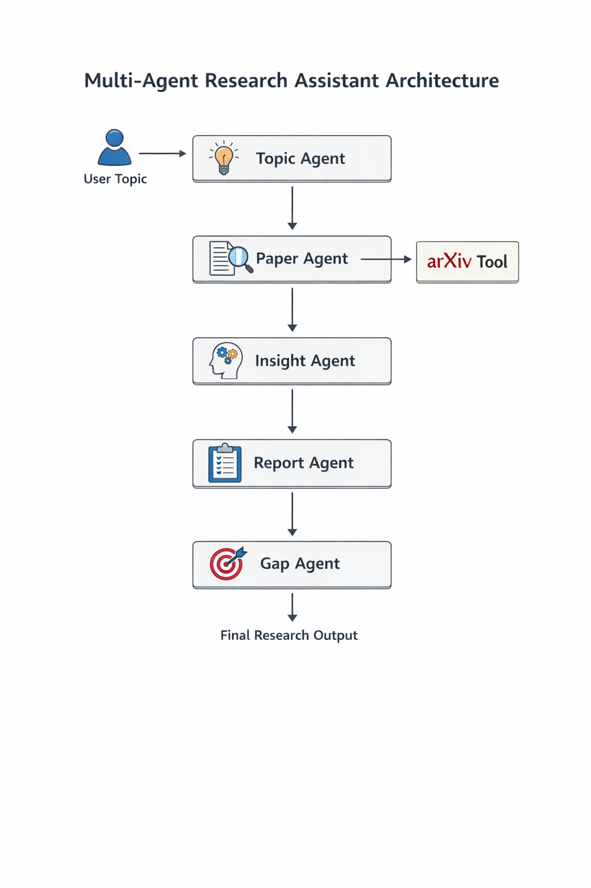

# 🧠 Multi-Agent Research Assistant (AutoGen)

A **multi-agent research assistant** built using **Microsoft AutoGen** that demonstrates how specialized LLM agents can collaborate to perform end-to-end research tasks such as topic refinement, paper discovery, insight extraction, report generation, and research gap analysis.

This project focuses on **agent orchestration patterns**, not production hardening.

---

## 🎯 Project Goal

The primary goal of this project is to:

- Understand **multi-agent coordination** using AutoGen
- Explore **agent specialization and task decomposition**
- Experiment with **tool-augmented agents**
- Compare **orchestration strategies** (Round-robin vs Selector)
- Run the system using a **local LLM (Ollama + Llama 3)** without cloud dependencies

This is an **educational and exploratory project**, not a production-ready research platform.

---

## ✨ Key Features

- 🤖 Multiple specialized agents with clearly defined roles
- 🔁 Two orchestration modes:
  - **RoundRobinGroupChat** (deterministic pipeline)
  - **SelectorGroupChat** (conditional + human-in-the-loop)
- 🛠 Tool integration using the **arXiv API**
- 🧠 Local LLM execution via **Ollama + Llama 3**
- 🧑‍⚖️ Optional **human approval step** using `UserProxyAgent`

---

## 🧱 Agent Responsibilities

| Agent | Responsibility |
|------|----------------|
| **Topic Agent** | Refines a broad research idea into a focused topic |
| **Paper Agent** | Finds relevant research papers using arXiv |
| **Insight Agent** | Extracts common insights from papers |
| **Report Agent** | Compiles a structured research report |
| **Gap Agent** | Identifies research gaps and proposes next steps |
| **User Proxy Agent** | (Optional) Approves or rejects intermediate steps |

Each agent is intentionally **single-purpose** to avoid “god agents”.

---

## 🏗️ Architecture

### High-Level Flow




---

## 🔁 Orchestration Strategies

### RoundRobinGroupChat
- Agents execute in a fixed sequence
- Simple and deterministic
- Easy to reason about

### SelectorGroupChat
- Dynamic agent selection
- Supports **human-in-the-loop approval**
- Useful for gated or review-based workflows

---

## 🧠 Model & Runtime

- **LLM**: Llama 3
- **Runtime**: Ollama (local)
- **Why local models?**
  - No external API dependency
  - Better data privacy
  - Predictable cost
  - Model portability

The model is injected via a **model abstraction layer**, making it easy to swap between local and cloud-based LLMs.

---

## 🛠 Tools Used

- **AutoGen** – multi-agent framework
- **Ollama** – local LLM runtime
- **arXiv API** – research paper retrieval
- **Python asyncio** – async orchestration

---

## 🚦 Termination & Safety Controls

- Maximum message limit
- Keyword-based termination (`FINAL REPORT`)
- Explicit orchestration boundaries

These prevent runaway agent conversations.

---

## ⚠️ Scope & Limitations

This project intentionally:

- Uses **message-based state** via AutoGen conversations
- Avoids explicit shared state objects
- Does not implement cost tracking, retries, or evaluations

> In production systems, this would be replaced with explicit state management, structured contracts, observability, and guardrails.

---

## ▶️ How to Run

### Prerequisites

- Python 3.10+
- Ollama installed and running
- Llama 3 pulled locally

```bash
ollama pull llama3

python main.py
```